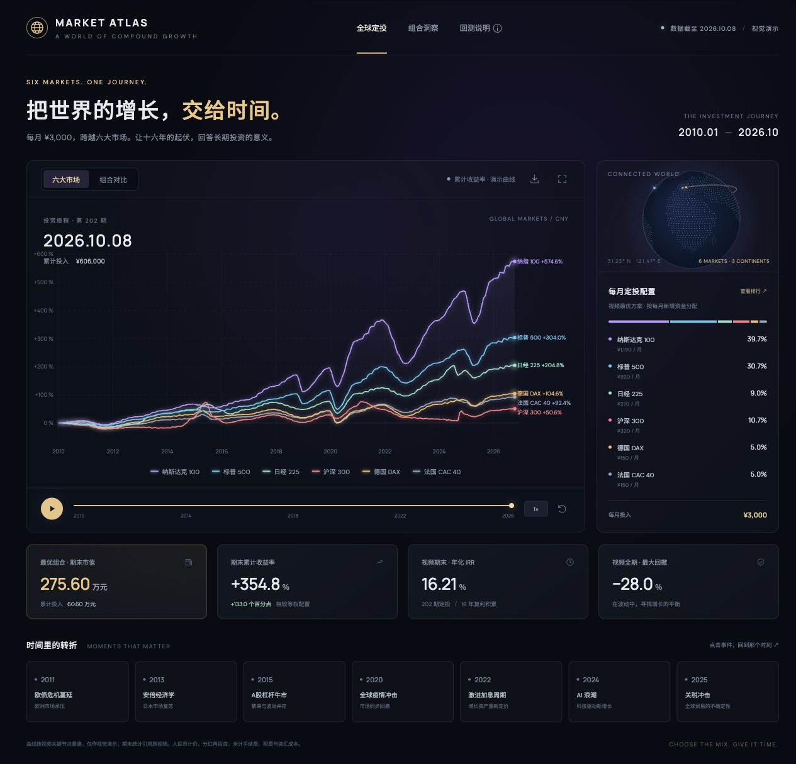

# Market Atlas · 全球定投实验

根据参考视频制作的独立前端项目。采用 Vite、原生 JavaScript、SVG 和 Canvas，不依赖后端。



## 环境要求

Node.js 20.19+ 或 22.12+，以及 npm。

## 启动

```bash
cd market-atlas
npm ci
npm run dev -- --port 5173
```

在浏览器打开 http://127.0.0.1:5173/ 。

## 构建

```bash
npm run build
npm run preview
```

构建产物位于 `dist/`，可部署到支持静态站点的服务器。

## 下载包与部署

GitHub Releases 提供两种 ZIP：

- `market-atlas-v1.0.0.zip`：完整项目，包含源码、锁定依赖版本、预览图与已构建的 `dist/`。不包含 `node_modules/`。
- `market-atlas-dist-v1.0.0.zip`：仅静态站点，解压后为 `index.html` 和 `assets/`，可直接上传到网站根目录。

源码包解压后，进入 `market-atlas/`，执行 `npm ci` 和 `npm run dev`。部署包无需安装 Node.js，将解压后的全部文件放到静态服务器根目录即可。

构建资源使用相对路径，可放在网站根目录，也可放在 `/market-atlas/` 这样的普通子目录。请通过 HTTP 静态服务器访问，不要直接双击 HTML 文件。

## 页面功能

- 六大市场收益曲线与最优、等权组合对比。
- Canvas 点阵地球、跨市场弧线、霓虹曲线和金色组合配色。
- 播放、暂停、重播、1× / 2× / 4× 速度与可拖动时间轴。
- 点击图例切换曲线显示；鼠标悬停读取各时点演示收益。
- 右侧切换每月定投配置和实时收益排行。
- 七个历史事件入口，点击后定位时间并展示背景。
- PNG 图表导出、全屏模式、回测说明弹窗。
- 手机端布局、键盘操作、弹窗焦点恢复与减少动态效果支持。

## 数据范围

期末数字和配置来自参考视频：累计投入 ¥606,000，最优组合期末市值 ¥2,756,014，总收益 354.8%，年化 IRR 16.21%，最大回撤 −28.0%，等权方案期末市值 ¥1,950,077。

**视频没有完整历史行情。** `src/data.js` 的中间路径由关键节点和确定性噪声重建，仅用于展示动画，不是真实逐日行情、独立回测或优化算法。市场路径与组合路径均为独立演示序列。视频中的最优比例由历史数据事后求解，存在后视偏差。页面脚注与说明弹窗均明确标注这些区别。

下方四个指标卡始终展示视频期末结果；主图与实时排行跟随时间轴变化。组合视图中的非期末市值明确标为演示值。

## 文件

- `src/main.js`：界面、SVG 图表、Canvas 地球与交互。
- `src/style.css`：配色、布局、响应式样式。
- `src/data.js`：市场资料、配置与演示曲线。

字体使用 Google Fonts，网络不可用时自动使用本地系统字体。其他视觉资产均由代码生成。
